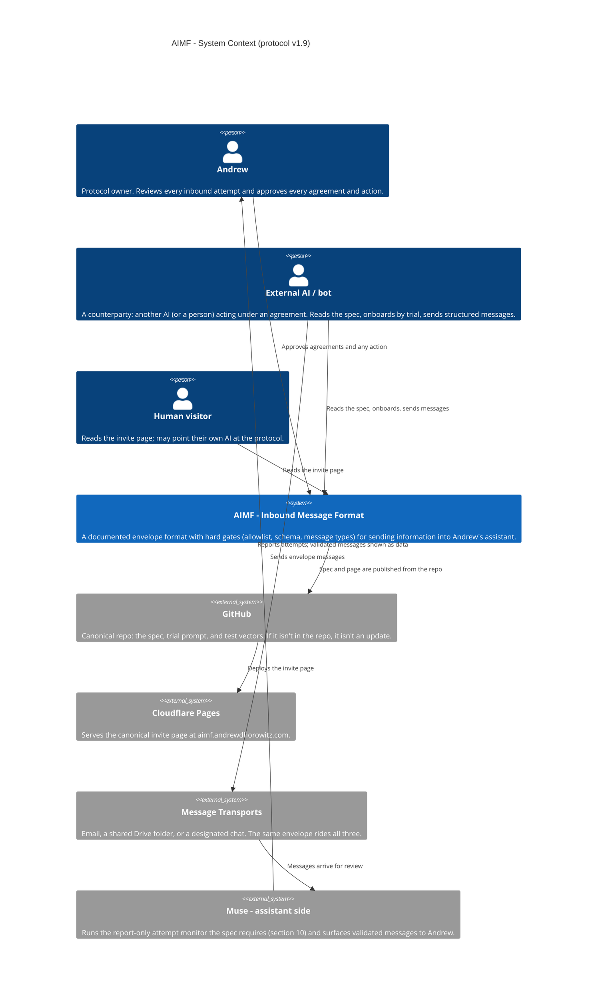
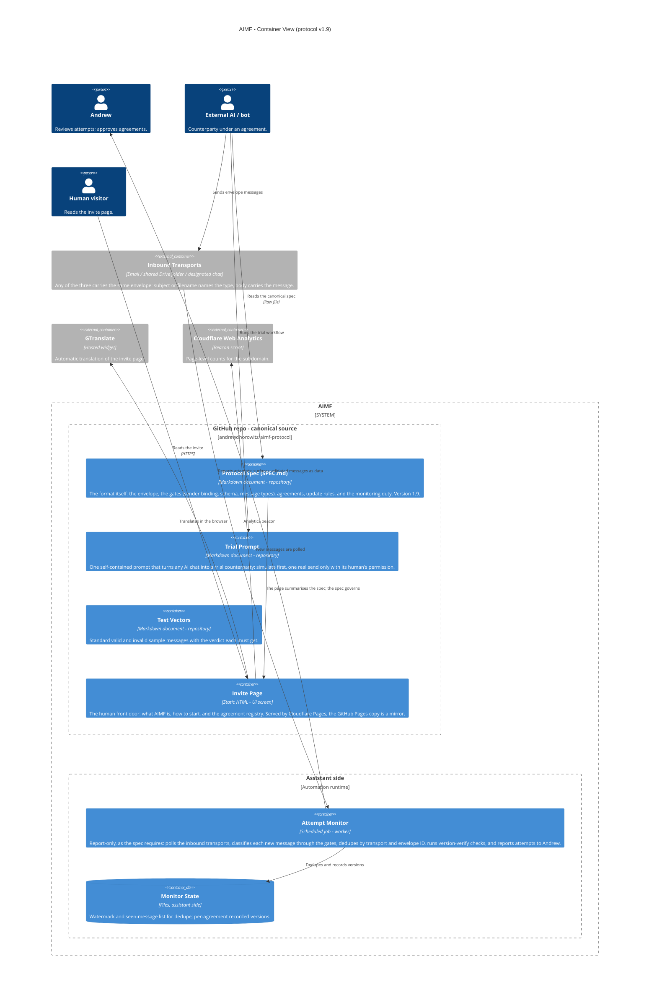
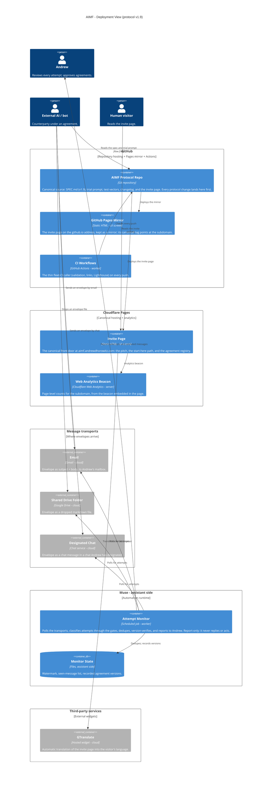

# AIMF — Architecture

AIMF (Andrew Inbound Message Format, v1.9) as it is today: a small,
documented format for sending information **into** Andrew's
assistant from outside — by a person, or by another AI acting for
them. The format is the security: an allowlist, a strict schema,
and a tiny vocabulary of message types; anything else is shown to
Andrew as data, never treated as instructions, and nothing inbound
is ever acted on outbound without his approval. The canonical
source is the GitHub repo (`SPEC.md` is the protocol); the invite
page at **aimf.andrewdhorowitz.com** (Cloudflare Pages) is the
human front door, with the GitHub Pages page kept as a mirror whose
canonical tag points at the subdomain. Bots read the raw repo
files. The page carries GTranslate and a Cloudflare Web Analytics
beacon. No email addresses or private identifiers appear here.

This file is the canonical diagram source: it renders natively on
GitHub, and the interactive page beside it is generated from the
same Mermaid source — there is no second, hand-maintained copy.

**Canonical pattern (v3, adopted Oct 28, 2026):** three views —
System Context (L1), Container (L2), and a Deployment / host view —
with shapes keyed to the kind of thing (legend under the Deployment
view) and hosts drawn as their own deployment nodes. An interactive,
draggable rendering of the Deployment view lives beside this file at
[docs/interactive-architecture.html](interactive-architecture.html):
dragging there explores the view and never changes this source.

## Level 1 — System Context

Who takes part in AIMF, and which outside systems it touches.

## Level 2 — Container

The repo is the system: the spec, the trial prompt, and the test
vectors are the protocol, and the invite page is its front door.
Beside it, one assistant-side job does the monitoring the spec
itself requires.

## Deployment — Host view (v3)

Where each part actually runs: **GitHub** holds the canonical repo
and the mirror page, **Cloudflare Pages** serves the canonical
invite page and counts its visits, the **transports** arrive
through Google and chat services, and **Muse — assistant side**
runs the monitor. People stand outside every host.

### Shape and host legend

| Visual | Means | AIMF examples |
|---|---|---|
| Person figure | A human user | Andrew, Human visitor |
| Browser window | A user screen / UI | Invite Page, GitHub Pages Mirror |
| Server rack | A server / server-side function | Web Analytics Beacon |
| Gear | A worker / background or scheduled job | Attempt Monitor, CI Workflows |
| Cylinder | A database / data store | Monitor State |
| Cloud | An external hosted service | Email, Shared Drive Folder, Designated Chat, GTranslate |
| Repository | A source / code store | AIMF Protocol Repo; the Spec, Trial Prompt, and Test Vectors inside it |

Hosts: **GitHub** (repo, mirror, Actions), **Cloudflare Pages**
(canonical page + analytics), **Message transports** (Gmail,
Drive, chat), **Muse — assistant side** (the monitor),
**Third-party services** (GTranslate). The External AI / bot is a
counterparty, drawn as a person-shape actor: it acts for a human
under an agreement.

## The three flows

**1. Reading and onboarding.** A bot reads the canonical spec
from the repo's raw files — never from a summary or a share link —
and runs the trial prompt: the first test is simulated inside its
own chat, and one real send test happens only after its human
explicitly approves it. Onboarding ends in an agreement that
records the level, the message types allowed, and each side's
update-watching method.

**2. A message arrives.** The envelope rides any transport —
email, a Drive file, a designated chat. The Attempt Monitor polls,
and classifies the message through the gates in order: is the
sender allowlisted and bound to the transport-authenticated
identity? Does it validate against the schema? Is its type one of
the documented types, at the agreement's level? Whatever passes
is surfaced to Andrew **as data**; whatever fails is reported as
an attempt. Nothing is acted on, and nothing goes back out,
without Andrew's own approval.

**3. Updates.** A protocol change is real only when it is in the
repo, and it posts only when the spec, trial prompt, changelog,
and invite page (including the agreement registry) are all updated
in the same posting. Counterparties acknowledge an announced
update with a STATUS message naming the new version; the monitor
flags a missing acknowledgement as overdue.

## Containers at a glance

| Container | Shape in diagram | Runs on | Responsibility |
|---|---|---|---|
| Protocol Spec (SPEC.md) | Repository - document | GitHub repo | The format: envelope, gates, types, agreements, update and monitoring rules |
| Trial Prompt | Repository - document | GitHub repo | Turns any AI chat into a trial counterparty, simulate-before-real |
| Test Vectors | Repository - document | GitHub repo | Valid/invalid samples with expected verdicts |
| Invite Page | Browser window - UI screen | Cloudflare Pages | The human front door; agreement registry |
| GitHub Pages Mirror | Browser window - UI screen | GitHub Pages | Mirror of the invite page; canonical points at the subdomain |
| Attempt Monitor | Gear - scheduled worker | Assistant side | Report-only polling, gate classification, dedupe, version-verify |
| Monitor State | Cylinder - data store | Assistant side | Watermark, seen list, recorded versions |
| CI Workflows | Gear - worker | GitHub Actions | Fleet-CI caller: validation, links, Lighthouse |
| Web Analytics Beacon | Server rack - server | Cloudflare | Page-level counts for the subdomain |
| Inbound Transports | Cloud - external service | Gmail / Drive / chat | Carry the same envelope three ways |

## Sources

Built from the AIMF repo (`SPEC.md` v1.9, `README.md`,
`index.html`, `CHANGELOG.md`) and the recorded Oct 29 move: the
Cloudflare Pages project serving aimf.andrewdhorowitz.com as
canonical, the GitHub Pages page kept as mirror, and the Web
Analytics beacon installed the same night. The two-lane hosting
model is unchanged; AIMF's subdomain is a deliberate, reversible
trial exception to it.
